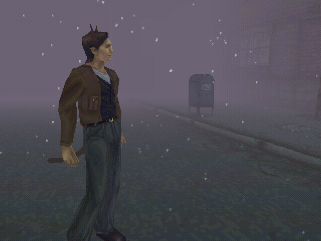
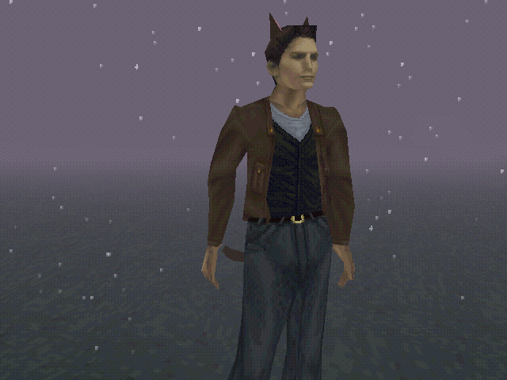
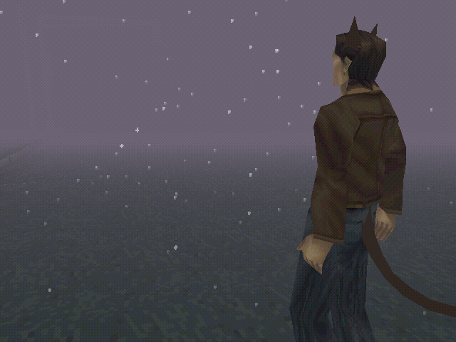
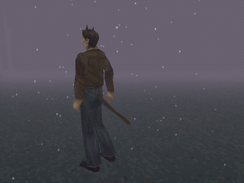

# Cat Harry

Cat ears and a swinging cat tail for Harry in the native PC and Android ports of **Silent Hill (1999)**.



| Front | Back |
| --- | --- |
|  |  |



The ears and tail are made in hair colour, sit on Harry's head and hips, and follow his animation. The tail is a little
spring-physics rope: it lags, swings when he turns, bobs as he walks, and droops with gravity. The ears hide in
first person so they don't block the view.

Every mesh is generated by `cat_harry_pack.py` from scratch. No game data is read or included.

## What works where

| Build | Status |
| --- | --- |
| Android, with the costume code (APK in Releases, or patch below) | Tested (Galaxy Z Fold6) |
| [Silent Hill DS dual-screen port](https://github.com/TheYellowBee/silent-hill-dualscreen) builds | Tested (Fold6, RG DS) |
| Stock Android port APK, unpatched | Does nothing: the game needs the costume code to load the pack |
| [PC port](https://github.com/SlickAmogus/silent-hill-decomp) with `patches/cat-harry-pc.patch` | Tested (Windows, `pc-port` branch at `488b518`) |
| Stock PC port, unpatched | Does nothing, same as the stock APK |

## Install (PC)

Build the [PC port](https://github.com/SlickAmogus/silent-hill-decomp) with the patch (Windows: MSYS2 MinGW64,
same as the PC port's own build steps):

```
git clone -b pc-port https://github.com/SlickAmogus/silent-hill-decomp
cd silent-hill-decomp
git checkout 488b518
git submodule update --init --recursive
git apply path/to/cat-harry-pc.patch
```

Then build it the way the PC port's README says. Put `halloween.shc` in a `mods` folder in the folder you start the
game from (next to `SilentHillPC.exe` if you double-click it):

```
mods/halloween.shc
```

Your saves stay where they were: it's the same game, just with the costume code added.

## Install (Android)

1. Install the APK from **Releases**. It installs as its own app, **com.silenthill.pc.cat**, next to any other
   Silent Hill port you already have, so nothing of yours is replaced. Set up the game files the same way as the
   [original port](https://github.com/WhoisMiau0x1/Silent-Hill-1999-Android-port) (your own `.bin` + `.cue` in
   **Download**).
2. Put `halloween.shc` (from Releases, or build it yourself below) in

   ```
   Android/data/com.silenthill.pc.cat/files/mods/halloween.shc
   ```

   Create the `mods` folder if it isn't there. Restart the game. To take the costume off, delete or rename the file.

On a build you made yourself from the patch, the folder is `Android/data/<that build's app id>/files/mods/`.

## Build the pack

Python 3, no packages needed:

```
python cat_harry_pack.py                 # writes halloween.shc
python cat_harry_pack.py --obj out/      # also writes ears.obj / tail.obj to look at in Blender
```

Tweak the shapes in `cat_ear()` / `cat_tail()`, the colours in `SWATCH`, or the tail's springiness in `pieces()`
(stiffness at the base and tip, damping, gravity, swish size and speed).

## Build the APK yourself

PC: see **Install (PC)** above.


`patches/cat-harry-android.patch` applies on top of
[WhoisMiau0x1/Silent-Hill-1999-Android-port](https://github.com/WhoisMiau0x1/Silent-Hill-1999-Android-port)
at commit `2deed30`:

```
git clone https://github.com/WhoisMiau0x1/Silent-Hill-1999-Android-port
cd Silent-Hill-1999-Android-port
git checkout 2deed30
git apply path/to/cat-harry-android.patch
```

That repo's submodules are empty links, and its code needs a newer PsyCross than the commit it pins
(`g_PsyX_OnWindowResize` and friends). Put SDL2 (`15ead9a`) and openal-soft (`d3875f3`) in `third_party/`, and
PsyCross ([SlickAmogus/PsyCross](https://github.com/SlickAmogus/PsyCross) `09aa645` + TODO: PsyCross changes) in
`silent_hill_src/pc_port/PsyCross/`, then build with Gradle. The patch adds `pc_costume.c/h` (loads the pack, runs the tail physics, draws
the pieces with the game's own lights) and a few hooks in the character draw code, all inside `#ifdef SH_PC_PORT`.
With no pack file, the game runs exactly as before.

## Credits

This mod stands on a lot of other people's work. Thank you all.

- **[Vatuu and the Silent Hill decomp team](https://github.com/Vatuu/silent-hill-decomp)**: turned the PS1 game back into readable code.
- **[SlickAmogus](https://github.com/SlickAmogus/silent-hill-decomp)**: the native PC port built on the decomp.
- **[WhoisMiau0x1](https://github.com/WhoisMiau0x1/Silent-Hill-1999-Android-port)**: the Android port this mod builds on.
- **PsyCross** (REDRIVER2 project): makes PS1 graphics run on modern devices.
- **SDL2** and **OpenAL Soft**: controls, screen and sound.

**This mod:** OffensiveNeon. Built with help from Claude (Anthropic's AI).

Licenses for the parts in the APK: [THIRD-PARTY-NOTICES.md](THIRD-PARTY-NOTICES.md).

## License

- `cat_harry_pack.py`: MIT ([LICENSE](LICENSE)).
- `patches/`: GPL-3.0-or-later, the same as the PC port code it changes (the Android port is built on it).

## Legal

This repository contains only original code and images captured from gameplay. No assets from Silent Hill are
included. Silent Hill is a trademark of Konami Digital Entertainment; this project is not affiliated with or
endorsed by Konami.
